# Guilherme Fachinelli

Estudo Engenharia de Controle e Automação na UTFPR, em Curitiba. Tenho interesse em automação de processos, integração de APIs e análise de dados. Busco estágio nessas áreas para aplicar o que aprendo em projetos reais.

## Iniciação científica

Pesquiso como estimar o tempo de chegada dos ônibus de Curitiba a partir de dados da URBS. O trabalho está na etapa de exploração da API e das leituras de localização dos veículos. O próximo passo é estruturar a coleta para avaliar a qualidade dos dados e, depois, testar métodos de previsão.

## Projetos selecionados

| Projeto | O que você encontra |
| --- | --- |
| [BackFortuna](https://github.com/Facnelli/BackFortuna) | Protótipo de API em Python com Flask e MySQL. Implementa cadastro e consulta de usuários e separa as rotas, as regras de negócio e o acesso ao banco. |
| [Leitura Confortável](https://github.com/Facnelli/Visualizador-facilitado-de-artigos) | Aplicação web para leitura de artigos acadêmicos, com destaques pesquisáveis e sincronização do progresso entre dispositivos. Usa TypeScript, Cloudflare Workers e D1. |

## Jogos e simulações

- [TicTacToe Roguelike](https://github.com/Facnelli/tic-tac-toe-godot) — jogo da velha com runas e combate em C# e Godot. A lógica de jogo é separada da interface e tem testes de regressão.

Gráfico de contribuições

<picture>
  <source media="(prefers-color-scheme: dark)" srcset="https://raw.githubusercontent.com/Facnelli/Facnelli/output/pacman-contribution-graph-dark.svg">
  <source media="(prefers-color-scheme: light)" srcset="https://raw.githubusercontent.com/Facnelli/Facnelli/output/pacman-contribution-graph.svg">
  
</picture>

